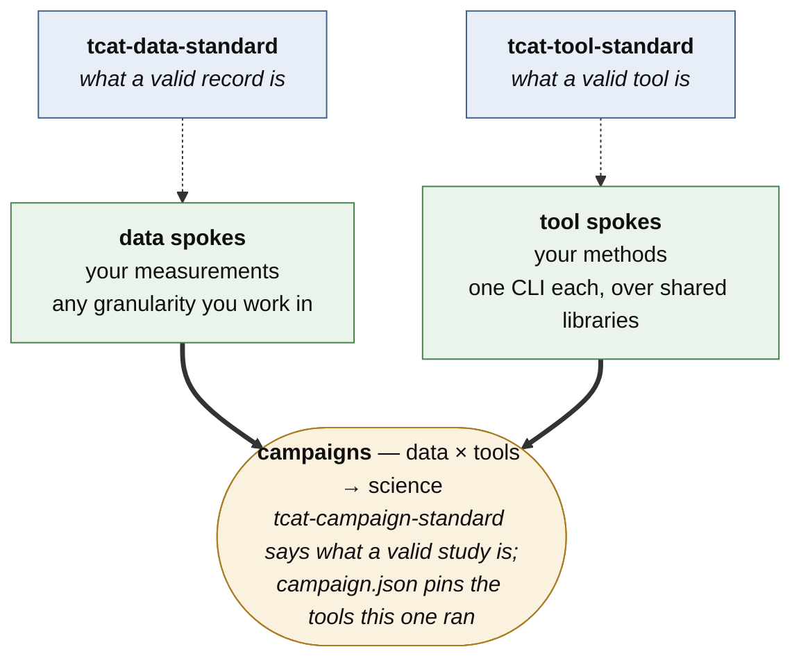

# TransientCatalysis

**An open software stack for transient kinetics: from an instrument file to a fitted, reduced and designed microkinetic model, with every result traceable to the data and the code that produced it.**

A transient experiment perturbs a reactor's inlet (a pseudo-random binary sequence, a step, a pulse train) and records the response. Minutes of such data can carry as much kinetic information as days of steady-state measurements, if the analysis is careful about what the data does and does not determine. This stack is that analysis, built so that someone else can check it:

- **Content-addressed results.** The same computation has the same id on any machine, so a result is a cache hit after a pull and a changed input is a changed id.
- **Provenance behind every number.** Each artifact records its inputs, its hashed parameters and the identity of the tool that made it, back to the raw file.
- **Standards that are checked.** A dataset validates against a schema, a tool is run against a contract by a checker that never imports it, and a study is held to the exact code its notebooks ran on.
- **Tools that say what they cannot determine.** A fit reports which constants the data identifies and refuses to quote an interval for the rest.

## The picture

*Dotted: the standard each side conforms to. Solid: measurements and methods meeting in a study.*

**The top row is the part that must not move.** There is one standard per kind of thing, and **none of them holds the thing itself**: the data standard holds no data, the tool standard holds no tools, the campaign standard holds no science. A standard that accumulated what it defines would become the place everyone edits, and then nobody could build against it.

**The bottom row is the part that is yours.** A data spoke is any repository whose records validate, at whatever granularity you work in. A tool spoke is one command over shared libraries. Nobody has to agree on how you work, only on what a valid record and a valid tool look like.

**Campaigns are where the two halves meet.** A method is written once, in its own repository, and reused by every campaign that wants it. A campaign's `campaign.json` pins the exact identity of every tool it ran, so a study stays reproducible without the tools having to be frozen.

## Repositories

| Repository | Role | What it is |
|---|---|---|
| [`tcat-data-standard`](https://github.com/TransientCatalysis/tcat-data-standard) | hub | What a valid **dataset** is: the document kinds, the validator, the ingestion contract, `tcat-spoke init`. |
| [`tcat-tool-standard`](https://github.com/TransientCatalysis/tcat-tool-standard) | hub | What a valid **tool** is: the contract, a machine-readable declaration per tool, the registries of names hashed into artifact ids, and the conformance checker. Holds no science. |
| [`tcat-campaign-standard`](https://github.com/TransientCatalysis/tcat-campaign-standard) | hub | What a valid **study** is: `campaign.json` as manifest and lockfile, the notebook kit and claim register, `tcat-campaign check`, and the tutorials. |
| [`tcat-kinetics`](https://github.com/TransientCatalysis/tcat-kinetics) | library | Mechanisms, integrators (gradientless, axially dispersed bed, error-controlled), transport, inlet reconstruction, thermochemistry. |
| [`tcat-spectra`](https://github.com/TransientCatalysis/tcat-spectra) | library | Spectroscopy numerics: Beer-Lambert, baselines, low-rank saliency, pseudo-Voigt band fitting, sensitivities of band areas. |
| [`tcat-spec`](https://github.com/TransientCatalysis/tcat-spec) | tool | Registers a model specification (a mechanism) as an artifact. |
| [`tcat-ingest`](https://github.com/TransientCatalysis/tcat-ingest) | tool | Converts an instrument file or a canonical CSV into a validated canonical-layer artifact. |
| [`tcat-fit`](https://github.com/TransientCatalysis/tcat-fit) | tool | Fits a microkinetic model to transient data, with derivative audits, guarded covariances and an identifiability verdict per constant. |
| [`tcat-profile`](https://github.com/TransientCatalysis/tcat-profile) | tool | Profile-likelihood intervals for a fit, minted as an artifact. |
| [`tcat-reduce`](https://github.com/TransientCatalysis/tcat-reduce) | tool | Reduces a mechanism to the parameters its data can support, one physical limit at a time. |
| [`tcat-design`](https://github.com/TransientCatalysis/tcat-design) | tool | Model-based design of the next experiment from a fit. |
| [`tcat-report`](https://github.com/TransientCatalysis/tcat-report) | tool | A TRACE-AI reporting checklist generated from accumulated provenance records. |
| [`tcat-calibrate-ms`](https://github.com/TransientCatalysis/tcat-calibrate-ms) | tool | The mass-spectrometer calibration chain, from raw ion counts to mole fractions. |
| [`tcat-calibrate-ir`](https://github.com/TransientCatalysis/tcat-calibrate-ir) | tool | Transient infrared: single-beam spectra to absorbance, and absorbance to band areas. |
| [`tcat-peaks-ir`](https://github.com/TransientCatalysis/tcat-peaks-ir) | tool | Discovers which bands a time series of infrared spectra supports. |
| [`tcat-data-synth-coox`](https://github.com/TransientCatalysis/tcat-data-synth-coox) | data spoke | Synthetic PRBS CO-oxidation data simulated from a known three-step model, with the truth recorded beside it. |
| [`tcat-campaign-synth-coox`](https://github.com/TransientCatalysis/tcat-campaign-synth-coox) | campaign | The worked example: fit, reduce and design on the synthetic data, checked against the known model. |

A **library** mints no artifacts; every tool that imports one declares it, so the library's source digest is part of the tool's identity. A **tool** is one command in one repository, with identity `name@<version>+<digest8>`, which `<command> --version` prints and a campaign pins.

## Where to start

1. **See it run.** [`tcat-campaign-synth-coox`](https://github.com/TransientCatalysis/tcat-campaign-synth-coox) is a complete study on synthetic data: one install block, two commands, two executed notebooks. It needs no access and nobody's measurements.
2. **Use it on your own data.** [`OUTSIDE-USE.md`](https://github.com/TransientCatalysis/tcat-campaign-standard/blob/main/OUTSIDE-USE.md) in the campaign standard is the whole path in your own account and in any domain: install, data spoke, tool spoke, campaign, CI.

After those two: the [tutorials](https://github.com/TransientCatalysis/tcat-campaign-standard/tree/main/examples) explain why the stack is shaped this way, and [`STANDARD.md`](https://github.com/TransientCatalysis/tcat-data-standard/blob/main/STANDARD.md) is the design document for the data model, in which each rule says why it exists.

Something in your way (an error that does not name the field, a rule that assumes catalysis, a document that is wrong)? Open an issue on the repository it belongs to.

## Standards

The data model is a **profile of** [TRACE-AI](https://github.com/trace-ai-org/trace-ai-checklist) (v2.2.0); see [`profiles/trace-ai/`](https://github.com/TransientCatalysis/tcat-data-standard/tree/main/profiles/trace-ai) for the field-by-field crosswalk and what it deliberately does differently.

> Xin, H. *et al.* "Transparent reporting for agentic catalysis enabled by artificial intelligence: Community guidelines and a publication checklist." *Chem Catalysis* (2026). [10.1016/j.checat.2026.101755](https://doi.org/10.1016/j.checat.2026.101755)

## Licensing

Software **MIT**. Documentation, tutorials and example workflows **CC-BY-4.0**. Public datasets **CC-BY-4.0**, or **CC0-1.0** where unrestricted reuse is preferred and permitted.

## Acknowledgment

Supported by the U.S. Department of Energy, Genesis Mission, award DE-SC0026638.
